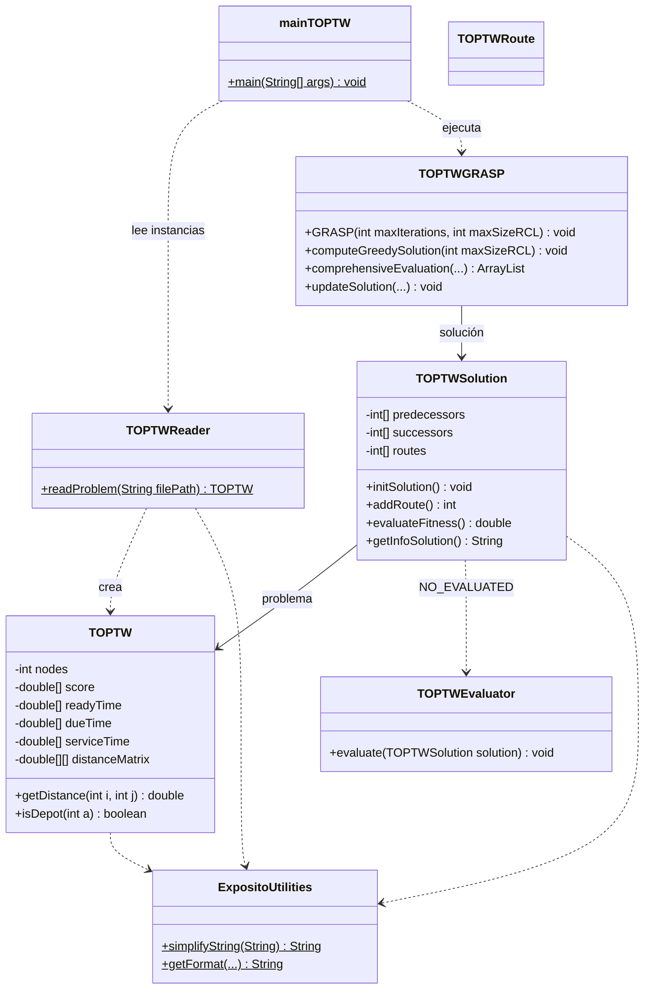
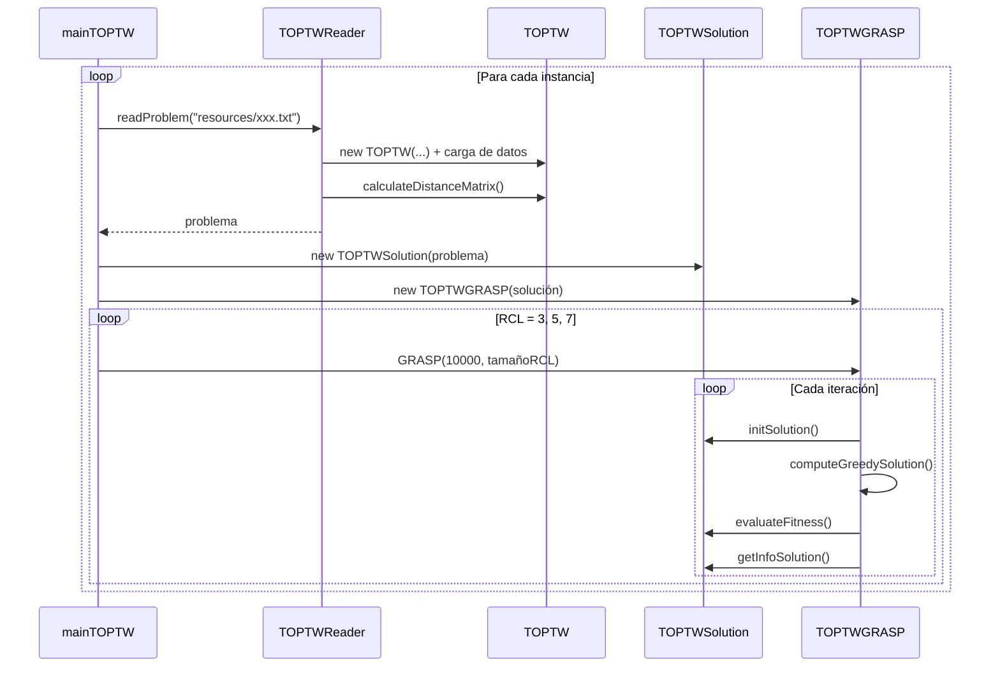
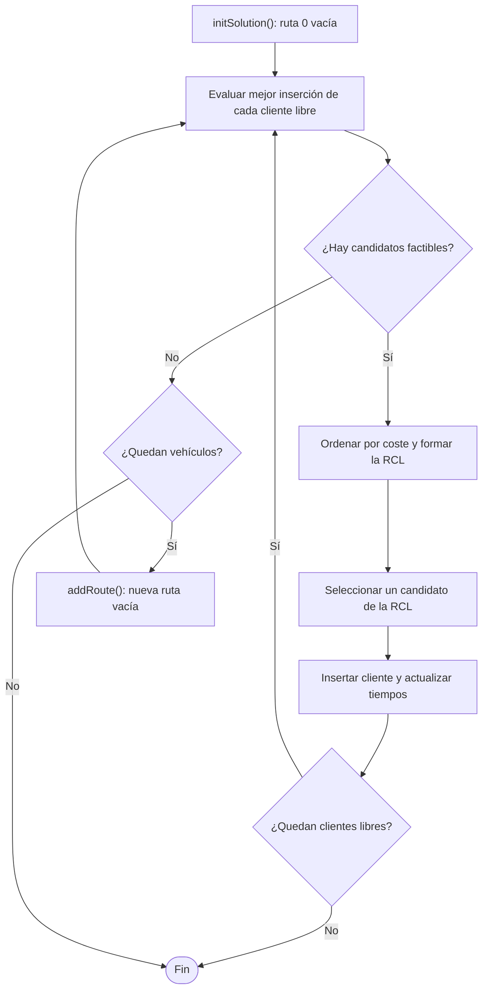

# Arquitectura del sistema

En esta sección se describe la arquitectura del proyecto
RTVRPTW, sus principales componentes y las relaciones
existentes entre ellos.

La documentación detallada de clases puede consultarse
en la referencia generada mediante Doxygen.

## Visión general

El sistema se organiza en cuatro responsabilidades bien separadas:

| Responsabilidad            | Clases                                   | Función                                                   |
|----------------------------|------------------------------------------|-----------------------------------------------------------|
| **Entrada de datos**       | `TOPTWReader`                            | Lee un fichero de instancia y construye el problema       |
| **Modelo**                 | `TOPTW`, `TOPTWSolution`, `TOPTWRoute`   | Representan el problema y sus soluciones                  |
| **Algoritmo**              | `TOPTWGRASP`, `TOPTWEvaluator`           | Construyen y evalúan soluciones                           |
| **Ejecución y utilidades** | `mainTOPTW`, `ExpositoUtilities` y otras | Programa principal y funciones auxiliares                 |

## Estructura de paquetes

| Paquete               | Contenido                                                                                      |
|-----------------------|------------------------------------------------------------------------------------------------|
| `top`                 | Modelo del TOPTW, lector de instancias, metaheurística GRASP y programa principal              |
| `exposito.utilities`  | Utilidades de propósito general: formateo de texto, matrices, grafos, `BellmanFord`, `Pair` y `PowerSet` |

## Diagrama de clases



!!! note
`TOPTWRoute` (par predecesor/sucesor), `TOPTWEvaluator.evaluate()` y las utilidades
`BellmanFord`, `Pair` y `PowerSet` no intervienen actualmente en el flujo principal del
algoritmo; son piezas reservadas o de apoyo.

## Flujo de ejecución



## Representación de la solución

Cada ruta es una **lista circular doblemente enlazada** que pasa por su depósito. Los enlaces se
guardan en dos vectores, `successors` y `predecessors`, indexados por identificador de nodo.

Ejemplo con dos rutas en una instancia de 100 POIs:

```text
Ruta 0 (depósito 0):    0 -> 5 -> 2 -> 9 -> 0
Ruta 1 (depósito 101):  101 -> 7 -> 14 -> 101

successors[0] = 5     successors[5] = 2     successors[2] = 9     successors[9] = 0
successors[101] = 7   successors[7] = 14    successors[14] = 101
```

- El sucesor del último POI es el depósito; el predecesor del depósito es el último POI.
- Una ruta vacía tiene el depósito como su propio predecesor y sucesor.
- La inserción de un POI tras un nodo `p` modifica únicamente cuatro enlaces, con coste
  constante.
- Los **depósitos adicionales** son copias del depósito `0` con identificadores `n + 1`,
  `n + 2`, ... (siendo `n` el número de POIs). Todas las consultas del modelo (`getX()`,
  `getDueTime()`, `getDistance()`...) traducen estos identificadores al nodo `0`.
- El vector `routes` guarda el depósito de cada ruta: `routes[k]` es el depósito de la ruta `k`.

!!! warning "Dos métodos `isDepot`"
`TOPTW.isDepot(a)` devuelve `true` si `a` es mayor que el número de POIs, mientras que
`TOPTWSolution.isDepot(c)` comprueba si `c` es el depósito de alguna ruta creada. El nodo
`0` es depósito para la solución, pero no para el problema.

## Estructuras de datos del algoritmo

| Estructura                       | Descripción                                                                                  |
|----------------------------------|----------------------------------------------------------------------------------------------|
| Candidato (`double[5]`)          | `[cliente, ruta, predecesor, coste, score]`                                                  |
| Tiempos de salida                | `ArrayList<ArrayList<Double>>`: para cada ruta, instante de salida de cada nodo (0 en el depósito) |
| Lista de clientes libres         | `ArrayList<Integer>` con los POIs aún no asignados                                           |
| Lista restringida (RCL)          | Subconjunto de los `maxSizeRCL` mejores candidatos ordenados por coste                       |

## Flujo de la construcción de una solución



## Decisiones de diseño

- **Matriz de distancias precalculada:** las consultas de distancia son accesos directos a una
  matriz simétrica, calculada una vez al leer la instancia.
- **Listas enlazadas por vectores:** permiten insertar y recorrer rutas sin copiar estructuras.
- **Evaluación exhaustiva de inserciones:** en cada paso se recalcula la mejor posición de
  todos los clientes libres (algoritmo adaptativo), a cambio de un mayor coste de cómputo.
- **Selección separada de la construcción:** `aleatorySelectionRCL()`,
  `fuzzySelectionBestFDRCL()` y `fuzzySelectionAlphaCutRCL()` son métodos independientes,
  lo que facilita incorporar nuevas estrategias.

Los detalles del algoritmo se desarrollan en la [Guía técnica](guia-tecnica.md) y la documentación
completa de cada clase está en la [Referencia del código](referencia-api.md).